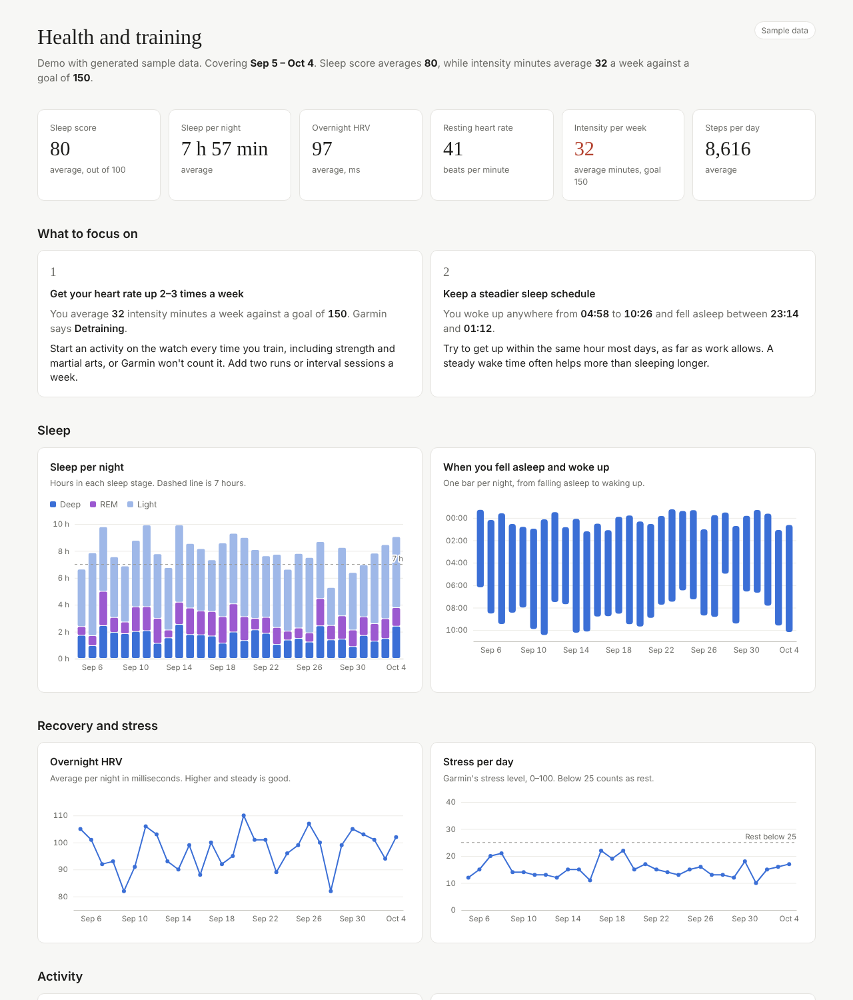

# Garmin Health Dashboard

Pull your own sleep, recovery and activity data out of Garmin Connect and explore it in a static dashboard that also tells you what to focus on.

**[Live demo](https://abshir-23.github.io/garmin-health-dashboard/)** (runs on generated sample data)



## What it shows

- **Key figures:** sleep score, sleep per night, overnight HRV, resting heart rate, weekly intensity minutes and daily steps
- **What to focus on:** rule-based recommendations computed from your numbers (too little high-intensity training, an irregular sleep schedule, falling step count, dropping HRV, a watch that hasn't synced)
- **Sleep:** time in each sleep stage per night, and when you fell asleep and woke up
- **Recovery:** overnight HRV and daily stress
- **Activity:** weekly intensity minutes against the goal, and daily steps
- **Fitness:** fitness age, resting heart rate and Garmin's predicted race times

## How it works

```
Garmin Connect API ──> garmin_dashboard/fetch.py ──> docs/data/*.csv ──> docs/index.html (d3.js)
                       (python-garminconnect)        (git-ignored)       static, no backend
```

1. `fetch.py` logs in with [python-garminconnect](https://github.com/cyberjunky/python-garminconnect), downloads the last *n* days and writes four CSV files.
2. `transform.py` holds the parsing logic as pure functions, which keeps it unit-testable without network access.
3. The dashboard is plain HTML, CSS and JavaScript. It loads `docs/data/` if it exists and falls back to `docs/sample/` otherwise.

## Run it with your own data

Requires Python 3.10+.

```bash
git clone https://github.com/Abshir-23/garmin-health-dashboard.git
cd garmin-health-dashboard
python -m venv .venv && source .venv/bin/activate
pip install -r requirements.txt

python -m garmin_dashboard.fetch --days 30     # asks for email, password and MFA code the first time
python -m http.server -d docs 8000             # open http://localhost:8000
```

Options: `--days` (1–365), `--end YYYY-MM-DD`, `--out <folder>`, `--tokenstore <folder>`, `-v`.

You can also set `GARMIN_EMAIL` and `GARMIN_PASSWORD` as environment variables instead of typing them.

## Security and privacy

Health data is sensitive personal data (a special category under GDPR article 9), so the project is built to keep it private by default:

| Risk | Mitigation |
|---|---|
| Real health data pushed to a public repo | Output goes to `docs/data/`, which is in `.gitignore`. The public demo uses generated data from `scripts/generate_sample_data.py`. |
| Password leaking through shell history or `ps` | No `--password` flag. Credentials come from environment variables or an interactive `getpass` prompt. |
| Stolen session tokens | After the first login only OAuth tokens are stored, in `~/.garminconnect` with `700` permissions. The password is never written to disk. |
| Cross-site scripting through data values | All values are inserted with `textContent`, never `innerHTML`. |
| Third-party script compromise | d3 is vendored in `docs/vendor/`, no CDN. A strict Content Security Policy (`default-src 'none'; script-src 'self'`) blocks inline and remote scripts. |
| Hammering Garmin's API | Requests are paced and rate-limit errors stop the run cleanly. |

The fetch script talks only to Garmin. Nothing is sent anywhere else.

## Development

```bash
pip install -r requirements-dev.txt
pytest                                       # unit tests for the parsers
ruff check . && ruff format --check .        # lint (includes bandit security rules) and formatting
python scripts/generate_sample_data.py       # regenerate the demo data
```

GitHub Actions runs the same checks on every push.

## Project structure

```
garmin_dashboard/
  fetch.py          CLI: login, download, write CSV
  transform.py      raw API responses -> flat rows (pure functions)
scripts/
  generate_sample_data.py
tests/
  test_transform.py
docs/               GitHub Pages site
  index.html
  assets/           app.js, style.css
  vendor/           d3 v7.9.0 (ISC license)
  sample/           generated demo data
```

## Disclaimer

Not affiliated with Garmin. The recommendations are simple rules based on general guidelines (for example 150 intensity minutes per week from the WHO), not medical advice.

## License

MIT
